# DNS Resolution Analyzer: Iterative Resolver from Raw Packets and DoT/DoH Comparison

**Course:** Computer Networks · **Project 17** · **Area:** DNS (topics 2.4, 3.3; CLOs 1–3)\
**Team:** Ali Khurram (24K-1000) · Mohsin Hassan (24K-1005) · Abuzar Mehdi (24K-630)

## Abstract

We built an iterative DNS resolver in Python that encodes and parses raw DNS messages (RFC 1035) without a DNS library. We ran it against a private DNS hierarchy (root, `.lab` TLD and authoritative servers, all BIND9) on a routed Docker topology of two Linux routers and four subnets. On the same topology we compared classic DNS (Do53) with DNS over TLS (DoT) and DNS over HTTPS (DoH), all served by Unbound.

Using `tc netem` on the transit link, we measured per-step and total resolution time, queries per lookup, first-query and repeat-query latency, handshake round trips and bytes per query. Each metric was measured under 20/100/200 ms RTT and 0/2/5 % loss, with 3 runs per condition.

At 200 ms RTT, a first query on a new connection took 859 ms over DoT and 700 ms over DoH, against 202 ms over Do53. On a reused connection, all three cost one round trip (202–206 ms). A one-query DoT session is 18 times the bytes of a Do53 exchange, and a DoH session 24 times.

## 1. Introduction and objectives

Do53 sends queries in plaintext over UDP 53, so any on-path observer can read or alter them. DoT and DoH encrypt DNS but add TCP and TLS handshakes, and DoH also adds HTTP/2 framing. This project makes resolution visible step by step and measures the price of encrypting it.

The objectives, from the proposal, were:

1. implement an iterative resolver from raw packets;
2. deploy a DNS hierarchy across 2 routers and at least 3 subnets;
3. measure per-step time and queries per lookup;
4. compare Do53/DoT/DoH latency for first and repeated queries;
5. evaluate every metric under three delay and three loss conditions;
6. capture and annotate every key exchange, including decrypted DoT/DoH.

## 2. Background

A DNS message is a 12-byte header (ID; flags QR, AA, TC, RD, RA; RCODE; section counts) followed by the Question, Answer, Authority and Additional sections. Names are length-prefixed labels and may end in a 2-byte compression pointer.

A *recursive* resolver (Unbound) answers RD=1 queries completely. An *iterative* resolver sends RD=0 queries from the root down and follows *referrals*: AA=0 replies that carry NS records in Authority and, for in-zone nameservers, *glue* A records in Additional. A referral **without glue** forces the resolver to resolve the nameserver's own name first. Without EDNS(0), a UDP reply over 512 bytes is truncated (TC=1) and must be retried over TCP 53.

**DoT** (RFC 7858) carries length-prefixed DNS messages over TLS on TCP 853. **DoH** (RFC 8484) carries each message as the body of an HTTP/2 `POST /dns-query` over TLS on TCP 443. With TLS 1.3, a new connection spends 2 RTTs (TCP, then TLS) before the query can be sent.

## 3. Network architecture and addressing

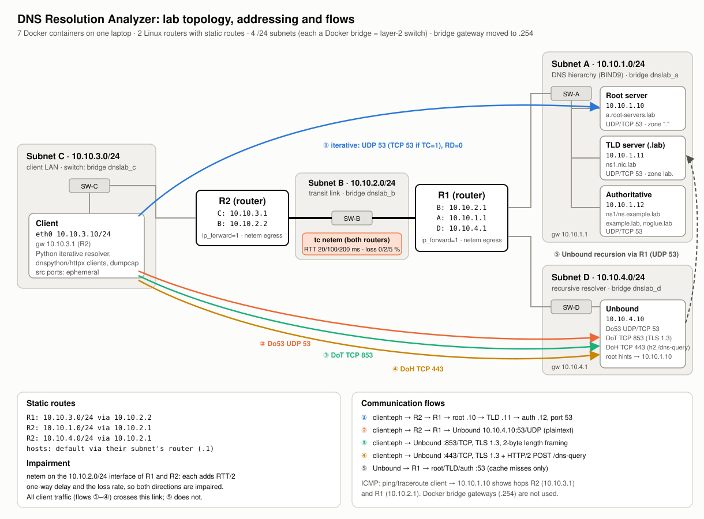

*Figure 1: Lab topology. Seven containers; each Docker network is a Linux bridge (layer-2 switch). Flows ①–④ cross the impaired R1–R2 link.*

| Subnet | Network | Purpose | Gateway |
|---|---|---|---|
| A | 10.10.1.0/24 | DNS hierarchy | R1 10.10.1.1 |
| B | 10.10.2.0/24 | Transit R1–R2, netem applied | – |
| C | 10.10.3.0/24 | Client with our resolver | R2 10.10.3.1 |
| D | 10.10.4.0/24 | Unbound recursive resolver | R1 10.10.4.1 |

| Node | Address | Ports | Software |
|---|---|---|---|
| R1 / R2 | 10.10.1.1, 10.10.2.1, 10.10.4.1 / 10.10.2.2, 10.10.3.1 | – | Linux, `ip_forward=1`, tc |
| Root `a.root-servers.lab` | 10.10.1.10 | UDP/TCP 53 | BIND 9.18, zone `.` |
| TLD `ns1.nic.lab` | 10.10.1.11 | UDP/TCP 53 | BIND, zone `lab.` |
| Authoritative `ns1/ns.example.lab` | 10.10.1.12 | UDP/TCP 53 | BIND, `example.lab.`, `noglue.lab.` |
| Unbound | 10.10.4.10 | 53, 853 (DoT), 443 (DoH) | Unbound 1.17, root hints → 10.10.1.10 |
| Client | 10.10.3.10 | ephemeral | Python 3.11, dnspython, httpx |

**Routing.** R1 routes 10.10.3.0/24 via 10.10.2.2. R2 routes 10.10.1.0/24 and 10.10.4.0/24 via 10.10.2.1. Every host replaces Docker's default route with its own router; Docker's bridge gateway was moved to `.254` so that the routers can own `.1`. A traceroute from the client to 10.10.1.10 crosses 10.10.3.1 (R2), then 10.10.2.1 (R1).

**Impairment.** `tc netem` runs on both routers' transit interfaces. Each router adds half the target RTT, and loss is applied independently in each direction.

**Zones.** `example.lab` is delegated with glue. `noglue.lab` is delegated to `ns.example.lab` without glue. `web.example.lab` is a CNAME. `big.example.lab` holds more than 512 bytes of TXT records, to force truncation.

## 4. Implementation

**Wire format (`resolver/dnsresolver/message.py`).** The module uses only `struct` and `ipaddress`. It builds queries with a random ID and RD=0, validating label (≤ 63) and name (≤ 255) lengths. It decodes names with compression pointers, with bounds checks and a jump limit against pointer loops. It parses all four sections and the A, AAAA, NS, CNAME, PTR, MX, SOA and TXT types; truncated replies are parsed as far as possible.

**Algorithm (`resolver.py`).**

1. Start at the root hint (10.10.1.10).
2. Send each query over UDP 53 from a new ephemeral port, and accept only a reply from that server with the matching ID. On a 1 s timeout, retry up to 3 times, then try the next nameserver.
3. If TC=1, repeat the query over TCP 53.
4. Act on the reply:
   * **answer:** done;
   * **CNAME:** restart from the root for the target;
   * **referral:** move to the delegated zone, but only if it is strictly closer to the name; take glue from Additional, and resolve any nameserver without glue by a recursive sub-lookup (depth ≤ 4);
   * **NXDOMAIN / NODATA:** stop.

Every query is recorded as a timed `Step` (server, zone, outcome, `perf_counter()` time, attempts, transport). The command-line tool prints the steps live, as in Figure A2.

**Testing.** Unit tests cover encoding, pointer decoding and loop rejection, and cross-check against dnspython in both directions. `experiments/verify.py` compares our answers with `dig @10.10.1.10 <name> +trace` for 7 name/type pairs (A, MX, NS, TXT, CNAME, no-glue): all 7 match. All 225 measured lookups returned the correct answer, including under 5 % loss.

**Infrastructure and clients.** One pinned Debian image serves every role (BIND9, Unbound, tc, dumpcap/tshark, Python). Unbound serves DoT on `tls-port` 853 and DoH on `https-port` 443 (`/dns-query`, HTTP/2), with an ECDSA certificate from a lab CA created at first start. `experiments/transports.py` frames each transport itself:

* **Do53:** one datagram per message;
* **DoT:** `SSLContext.wrap_socket`, TLS 1.3, with a 2-byte length prefix;
* **DoH:** an `httpx` HTTP/2 POST.

Each client measures a *first query* (new connection, including the handshakes) and *repeat queries* (one open connection). TLS secrets are written with `SSLContext.keylog_filename` for decryption. The DoT client sets `TCP_NODELAY`, as real stubs do, and httpx does the same for DoH. Without it, Nagle's algorithm held our query back until the server ACKed the TLS Finished, costing an extra RTT (Section 9).

**Proof of concept.** `python scripts/demo.py` shows, in order:

1. the routing tables and the traceroute;
2. the step-by-step iterative resolution of `www.example.lab`;
3. the `dig +trace` comparison;
4. the missing-glue sub-lookup;
5. the TC=1 to TCP fallback;
6. the Do53/DoT/DoH latencies;
7. the same tests at 200 ms RTT.

## 5. Packet capture evidence

All traces are in `captures/evidence/` (`*_with_keys` copies embed the TLS secrets), and their filters are in `docs/capture_guide.md`.

| Trace | What it proves |
|---|---|
| 01 ICMP/traceroute | Routed path: Time Exceeded from R2 (10.10.3.1), then R1 (10.10.2.1); TTL 62 at the root |
| 02 Iterative Do53 | RD=0 queries to .10/.11/.12 on UDP 53; referrals with AA=0, NS + glue; final AA=1 |
| 03 Missing glue | Referral for `noglue.lab` with ARCOUNT=0, then a full lookup of `ns.example.lab` |
| 04 Truncation | UDP reply with TC=1, then TCP 53 handshake and full answer |
| 05 / 05b Recursive Do53 | Plaintext RD=1/RA=1 exchange with Unbound; Unbound's own upstream iteration |
| 06 DoT | TCP 853, TLS 1.3, then only Application Data; with keys, the DNS query and response |
| 07 DoH | TCP 443, TLS 1.3 + ALPN h2, HTTP/2 `POST /dns-query`; DNS in DATA frames when decrypted |
| 08 Loss | UDP query resent after the 1 s timeout (same ID) vs TCP retransmission inside DoT |

The figures are screenshots of the Wireshark 4.0 GUI. In each, the key packet is selected and expanded, and numbered red boxes mark the relevant packets and fields. **Appendix A has all ten, one per exchange.**

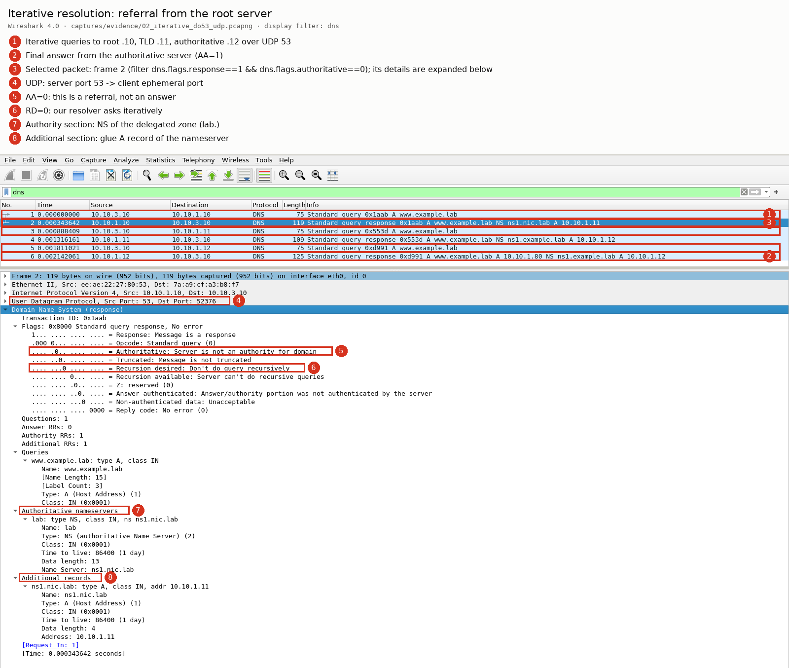{width=3.6in}

*Figure 2: Root referral (trace 02): UDP source port 53, AA=0, RD=0, NS `lab.` in Authority, glue `ns1.nic.lab A 10.10.1.11` in Additional.*

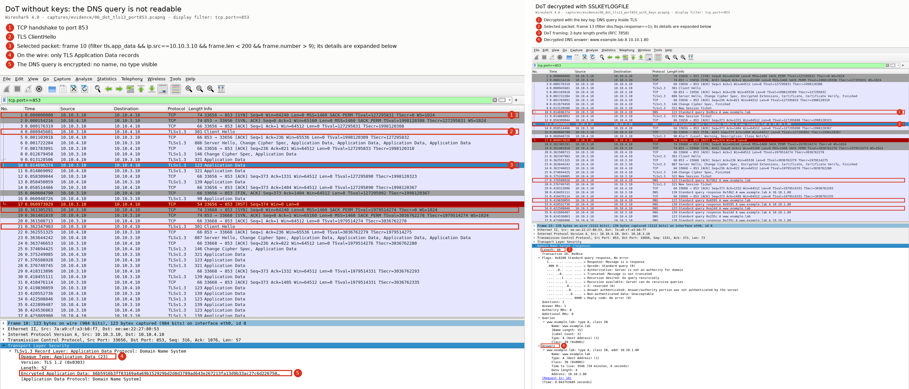{width=6.2in}

*Figure 3: The same DoT query without the key log (left: only `Application Data`) and with it (right: the DNS response and the 2-byte DoT length prefix).*

## 6. Experimental methodology

**Conditions** (netem on R1–R2): a delay sweep of 20, 100 and 200 ms RTT with no loss, and a loss sweep of 0, 2 and 5 % per direction at 20 ms RTT. This gives 5 distinct conditions, each run **3 times**, with Unbound's cache flushed before every run.

**One run** (`experiments/measure.py`, driven by `scripts/run_experiments.py`):

1. capture the run with `dumpcap`;
2. send one cold Do53 query;
3. make 5 iterative lookups of each test name;
4. for each transport, make 5 first queries and 10 repeat queries on one warm connection (Unbound's cache is warm, so only the transport is compared);
5. run a marked "wire" phase, analysed with tshark and the key log.

The wire phase yields:

* **bytes per 1-query session;**
* **bytes per repeat query:** (bytes of an 11-query session − bytes of a 1-query session) / 10;
* **handshake round trips:** (first DNS query − SYN) / (SYN-ACK − SYN);
* **packets up to the first response;**
* **the wire time of each iterative lookup**, which cross-checks the resolver's `perf_counter()` timer.

**Statistics.** Samples are averaged per run. Across the 3 runs, `analysis/analyze.py` reports the **mean ± sample standard deviation and the min–max range**.

## 7. Results

Every cell is the mean ± sd [min–max] over 3 runs. All metrics and conditions are in `results/experiment_table.md`.

**Table 1. Latency in ms.**

| Metric | 20 ms / 0 % | 100 ms / 0 % | 200 ms / 0 % | 20 ms / 2 % | 20 ms / 5 % |
|------------|--------|--------|--------|--------|--------|
| Iterative total, www.example.lab | 65.5 ± 1.7 [64.2–67.4] | 303.9 ± 1.2 [303.0–305.3] | 605.3 ± 1.8 [603.5–607.1] | 198.8 ± 116.1 [64.7–265.9] | 400.7 ± 231.6 [264.7–668.1] |
| Iterative total, mail.example.lab | 66.1 ± 2.0 [64.1–68.1] | 303.4 ± 0.6 [302.7–304.0] | 606.6 ± 1.0 [605.5–607.4] | 265.6 ± 198.8 [66.2–463.9] | 533.3 ± 231.4 [266.1–667.4] |
| Iterative total, www.noglue.lab | 131.9 ± 3.4 [128.5–135.2] | 606.9 ± 2.2 [605.0–609.3] | 1211.9 ± 2.9 [1209.2–1214.9] | 330.8 ± 347.3 [127.3–731.9] | 934.4 ± 528.1 [538.5–1534.1] |
| First query Do53 | 22.8 ± 0.7 [22.3–23.6] | 101.8 ± 0.7 [101.2–102.5] | 202.0 ± 0.4 [201.6–202.4] | 89.7 ± 116.9 [22.0–224.7] | 89.1 ± 115.3 [21.5–222.3] |
| First query DoT | 139.5 ± 5.0 [134.0–143.9] | 458.7 ± 8.9 [451.0–468.4] | 859.1 ± 1.6 [857.3–860.4] | 179.2 ± 23.1 [153.6–198.6] | 307.7 ± 144.5 [143.8–416.6] |
| First query DoH | 115.6 ± 21.1 [102.9–139.9] | 337.7 ± 5.9 [333.3–344.4] | 699.6 ± 8.9 [691.1–708.7] | 224.2 ± 115.8 [135.5–355.2] | 203.8 ± 119.2 [119.6–340.2] |
| Repeat query Do53 | 22.6 ± 0.8 [21.8–23.4] | 101.2 ± 0.2 [101.0–101.3] | 201.8 ± 0.3 [201.5–202.1] | 55.6 ± 58.3 [21.8–122.9] | 121.9 ± 100.2 [21.8–222.3] |
| Repeat query DoT | 22.4 ± 0.8 [21.5–23.1] | 101.4 ± 0.5 [101.1–102.0] | 202.1 ± 0.5 [201.7–202.6] | 21.9 ± 1.1 [21.2–23.2] | 29.5 ± 13.5 [21.4–45.0] |
| Repeat query DoH | 23.8 ± 2.4 [21.9–26.5] | 103.3 ± 0.5 [102.8–103.8] | 206.1 ± 0.9 [205.4–207.1] | 44.9 ± 28.1 [26.9–77.3] | 52.2 ± 27.4 [32.8–83.5] |
| Do53 via Unbound, cold cache | 28.3 ± 5.0 | 104.3 ± 0.9 | 207.6 ± 5.4 | 35.7 ± 6.2 | 34.4 ± 11.6 |

* **Queries per lookup:** 3.00 for `www`/`mail.example.lab` and 6.00 for `www.noglue.lab`, in every condition (sd 0). At 5 % loss, retries raised the packets sent to 3.33 and 6.80.
* **Per-step time:** 21.5–22.2 ms at 20 ms RTT, 100.8–101.4 ms at 100 ms and 201.3–202.3 ms at 200 ms.
* **Failures:** no lookup or query failed.

**Table 2. Wire cost per transport** (from the run captures; 20 ms / 0 % unless stated).

| Transport | RTTs before the query (20 ms) | RTTs before the query (200 ms) | Packets to first response | Bytes, 1-query session | Bytes per repeat query |
|---|---|---|---|---|---|
| Do53 | 0 | 0 | 2 | 166 | 166 |
| DoT | 3.32 ± 0.26 | 2.11 ± 0.06 | 13 | 3047 ± 1 | 264 ± 8 |
| DoH | 3.44 ± 0.12 | 2.34 ± 0.13 | 21 | 4019 ± 1 | 732 ± 4 |

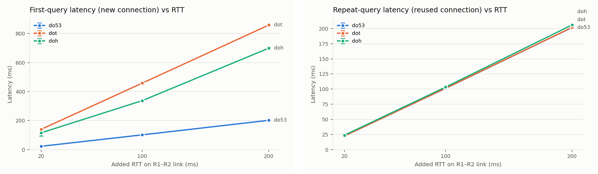{width=6.2in}

*Figure 4: First-query (left) and repeat-query (right) latency vs RTT; error bars = sd over 3 runs.*

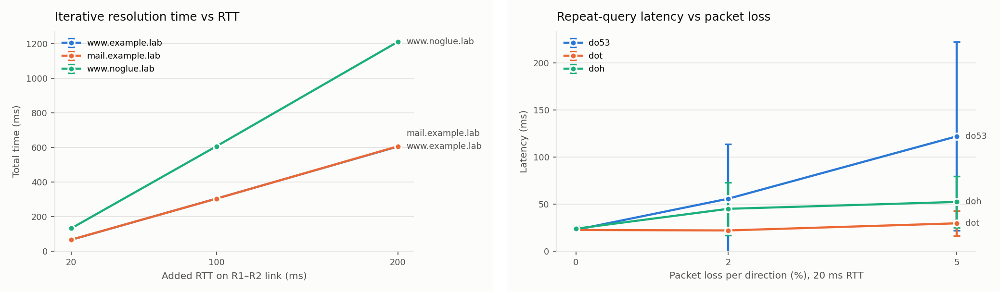{width=6.2in}

*Figure 5: Iterative time vs RTT (left) and repeat-query latency vs loss (right). More graphs are in `results/plots/`.*

## 8. Discussion

**Iterative time scales with queries × RTT (confirmed).** From 20 to 200 ms RTT, total time grew by 3.00 ms per ms of RTT for `www.example.lab` and by 6.00 for `www.noglue.lab`, exactly the number of queries. Missing glue doubled both the queries and the time (1211.9 vs 605.3 ms at 200 ms). Each step costs one RTT plus about 1.5 ms of processing. The resolver's timer exceeded the packet-timestamp time by only 0.38–1.29 ms, so the per-step times measure the network.

**First DoT/DoH queries are slower than Do53, by more than expected.** At 100 and 200 ms RTT, the captures show 2.11–2.34 RTTs before the query: exactly the TCP and TLS 1.3 handshakes. At 20 ms the ratio is 3.3–3.4, because about 10 ms of client CPU time (certificate verification) becomes comparable to the RTT.

First-query latency grew by 4.00 ms per ms of RTT for DoT and 3.24 for DoH, against the expected 3 (two handshake RTTs plus one for the query). The DoT trace explains the excess. Unbound sends two TLS 1.3 *NewSessionTicket* records, and its DNS response then waits behind the unacknowledged second ticket (Nagle's algorithm) until the client's delayed ACK arrives. That costs about 40 ms plus one RTT. DoH suffers less, because the HTTP/2 SETTINGS exchange makes the client ACK earlier. Our own DoT client lost one more RTT the same way until we set `TCP_NODELAY`, so TCP small-segment behaviour matters for encrypted DNS.

**Connection reuse removes the overhead (confirmed).** Repeat queries cost one RTT on every transport: at 200 ms, 201.8 (Do53), 202.1 (DoT) and 206.1 ms (DoH). The slopes are 1.00, 1.00 and 1.01. DoH stays 1–4 ms higher because of HTTP/2 framing and HPACK. The cost of encryption is concentrated in the first query.

**Bytes: DoH > DoT > Do53 (confirmed).** A one-query session took 166 B for Do53, 3047 B for DoT (18×) and 4019 B for DoH (24×), mainly the certificate, the handshake and the session tickets. On an open connection the costs are 166, 264 (1.6×) and 732 B (4.4×). The extra comes from the TLS record overhead and, for DoH, HEADERS and DATA frames in both directions.

**Loss: TCP recovers faster on open connections.** Each lost Do53 packet costs the 1 s application timeout. At 5 % loss, repeat Do53 averaged 121.9 ± 100.2 ms (range 21.8–222.3), while DoT stayed at 29.5 ± 13.5 ms because TCP retransmits after an RTO of about 200 ms. On new connections the advantage reverses: a lost SYN or handshake flight costs a 1 s RTO, and first-query DoT reached 307.7 ± 144.5 ms.

Iterative resolution suffers most, since every lookup sends 3–6 independent UDP queries: `www.noglue.lab` took 934 ± 528 ms at 5 % loss, against 132 ms with no loss. Loss events are rare and costly, which explains the wide spread in the loss columns.

**Cache and privacy.** A cold Do53 query was only 2–6 ms slower than a warm one, because Unbound reaches the hierarchy through R1 without crossing the impaired link. In trace 05 the name and address are readable by anyone on the path. With DoT/DoH an observer sees only the IP, port, record sizes and timing, and DoH shares port 443 with ordinary web traffic. The resolver's own upstream queries (trace 05b) remain plaintext.

## 9. Limitations and conclusion

**Limitations.**

* All nodes share one kernel, so the results are best read as differences between conditions and transports, not absolute times.
* netem loss is random. With 3 runs, the loss results have wide intervals.
* The extra first-query RTT is specific to Unbound 1.17's session tickets combined with Nagle's algorithm.
* We used no EDNS(0), DNSSEC, TLS resumption or 0-RTT.

**Conclusion.** The raw-packet resolver matches `dig +trace`, and the lab quantified both the cost of resolution and the cost of encrypting it:

* iterative resolution costs exactly one RTT per query, and missing glue doubles it;
* encryption costs 2–3 extra RTTs and 18–24 times the bytes on a new connection, but almost nothing on a reused one;
* on open connections, TCP recovers from loss faster than Do53's 1 s retry.

DoT and DoH therefore work best with long-lived connections and `TCP_NODELAY`.

**Reproducibility.** `README.md` gives the commands to start the lab (`docker compose up -d --build`), run the demo, record the captures and repeat every experiment (`python scripts/run_experiments.py`). All versions are pinned, and the raw CSVs, captures and key logs are included.

**AI-use disclosure.** See `AI_DISCLOSURE.md`. Claude (Anthropic) generated a first version of the code, configuration and documentation. All measurements come from running the experiments.

## References

1. P. Mockapetris, *RFC 1034/1035: Domain Names: Concepts and Facilities / Implementation and Specification*, 1987.
2. Z. Hu et al., *RFC 7858: Specification for DNS over Transport Layer Security (TLS)*, 2016.
3. P. Hoffman, P. McManus, *RFC 8484: DNS Queries over HTTPS (DoH)*, 2018.
4. E. Rescorla, *RFC 8446: The Transport Layer Security (TLS) Protocol Version 1.3*, 2018.
5. J. Damas et al., *RFC 6891: Extension Mechanisms for DNS (EDNS(0))*, 2013.
6. NLnet Labs, *Unbound documentation: unbound.conf(5)*; ISC, *BIND 9 Administrator Reference Manual*.
7. Linux `tc-netem(8)` manual; Wireshark User's Guide (TLS decryption with key log files).

## Appendix A. Annotated Wireshark screenshots
One screenshot per key protocol exchange (traces in `captures/evidence/`, images in `captures/screenshots/wireshark/`).

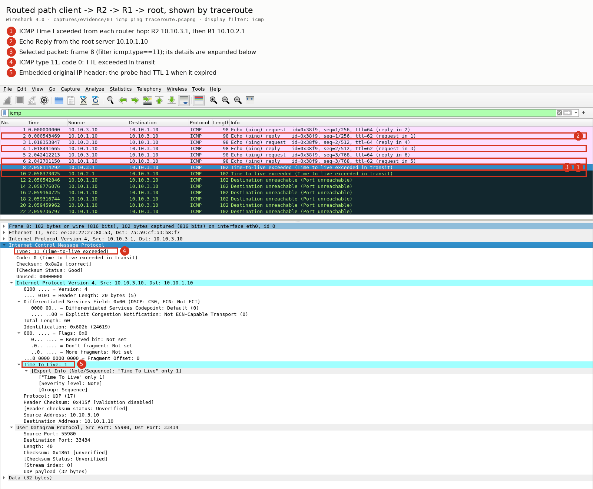{width=7in}

*Figure A1: ICMP Time Exceeded from R2 (10.10.3.1) and R1 (10.10.2.1); the embedded probe had TTL 1. Echo replies arrive with TTL 62 (two routers).*

{width=7in}

*Figure A2: Root referral: UDP source port 53, AA=0, RD=0, NS `lab.` in Authority, glue `ns1.nic.lab A 10.10.1.11` in Additional.*

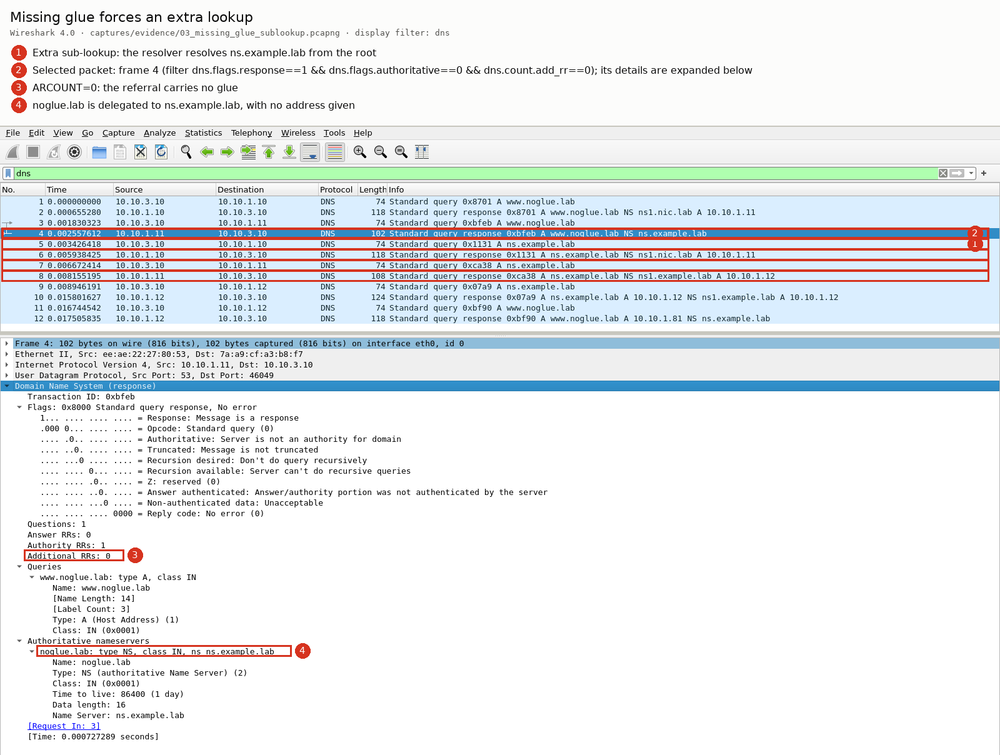{width=7in}

*Figure A3: The `.lab` referral for `noglue.lab` has Additional RRs: 0; the next packets resolve `ns.example.lab` first.*

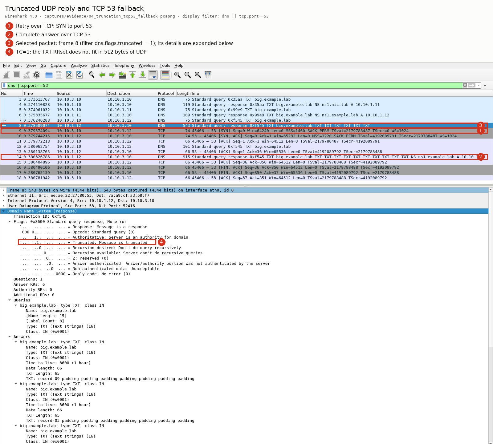{width=7in}

*Figure A4: TC=1 on the 543-byte UDP reply, then a TCP SYN to port 53 and the complete 915-byte answer over TCP.*

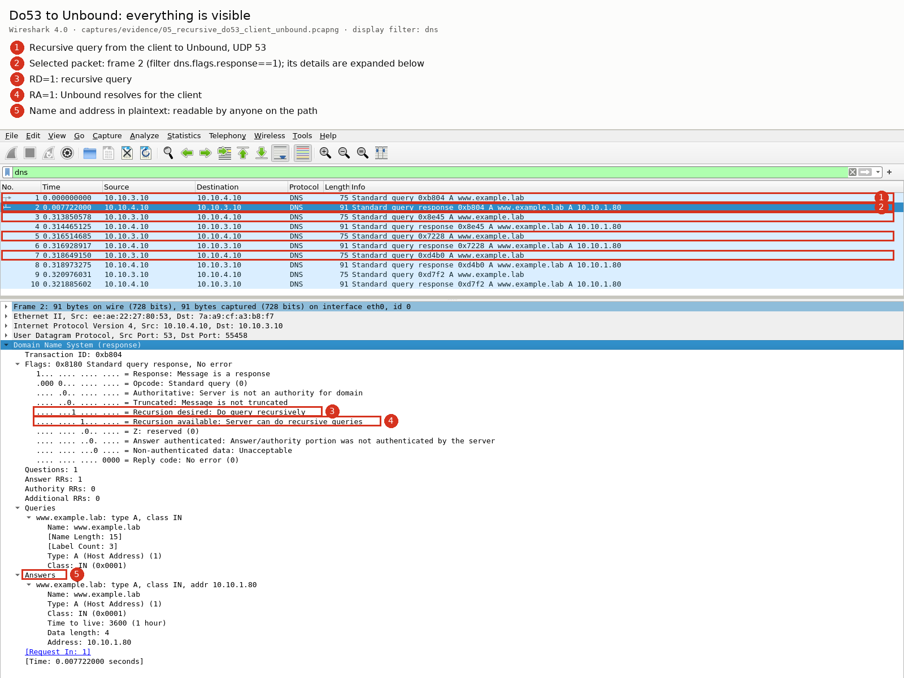{width=7in}

*Figure A5: Do53 to Unbound: RD=1, RA=1; the query name and address can be read in plaintext.*

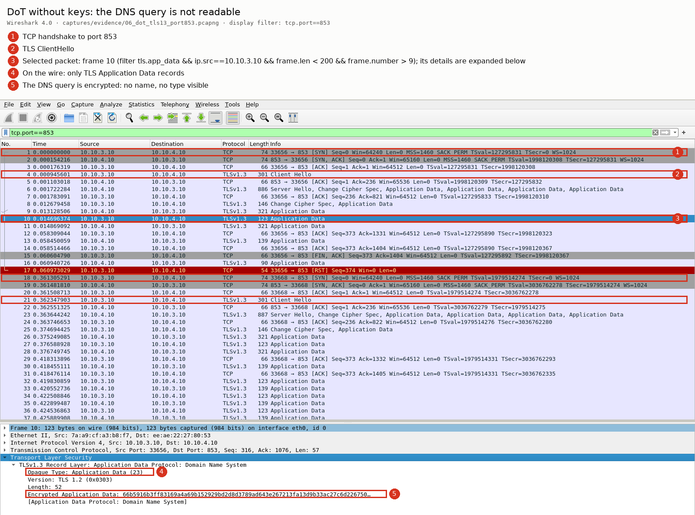{width=7in}

*Figure A6: DoT without the key log: the query packet holds only `Opaque Type: Application Data` and encrypted bytes.*

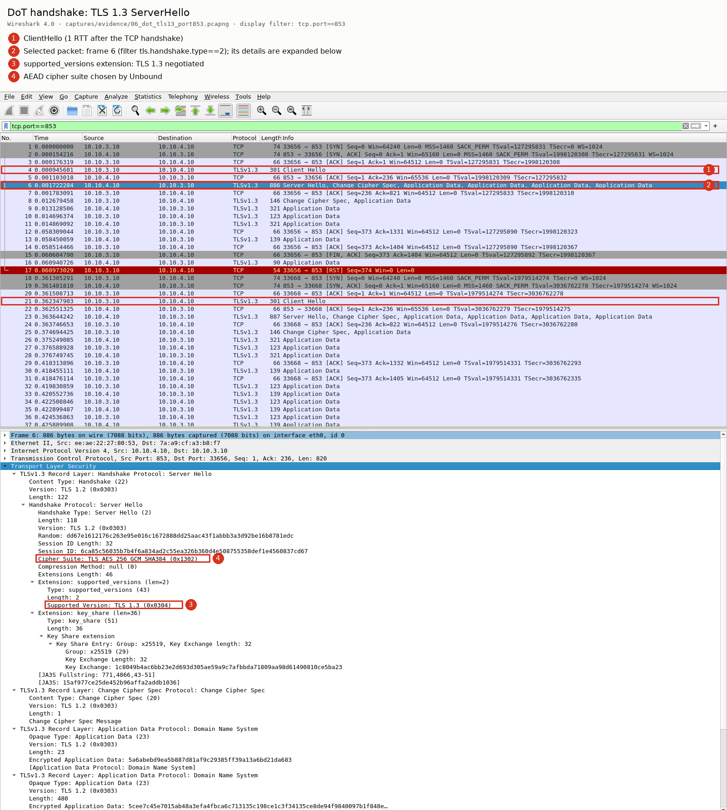{width=7in}

*Figure A7: ServerHello: `supported_versions` = TLS 1.3 (0x0304), cipher suite TLS_AES_256_GCM_SHA384.*

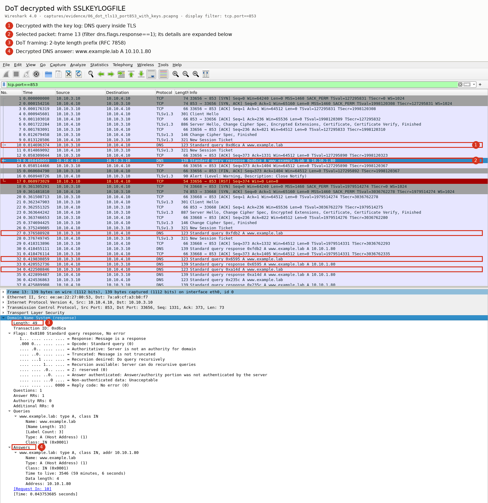{width=7in}

*Figure A8: The same DoT trace with the TLS secrets embedded: Wireshark shows the DNS messages and the 2-byte DoT length prefix.*

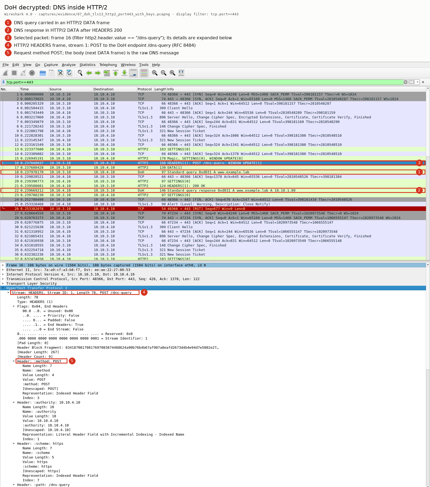{width=7in}

*Figure A9: DoH decrypted: HTTP/2 HEADERS `POST /dns-query`; DNS query and response in DATA frames.*

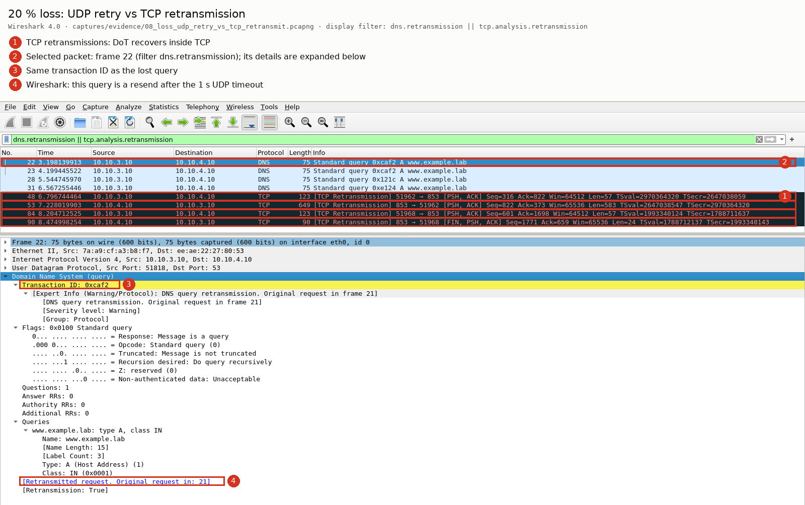{width=7in}

*Figure A10: 20 % loss: a DNS query resent with the same ID after the 1 s UDP timeout, and TCP retransmissions in the DoT sessions.*
